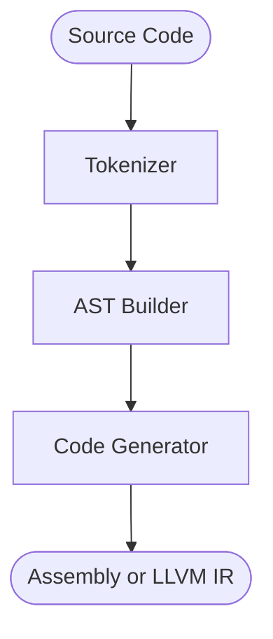

# dynamite-compiler

A compiler for a language with syntax similar to the C language, written in Rust

> [!IMPORTANT]
> This project is development phase and is not ready for use.

## Architecture

This program adopts pipeline architecture and processes source code as input in the flow depicted in the diagram below, resulting in assembly language or LLVM IR output.

## Global array initialization

Assembly and LLVM output support zero-initialized global arrays and brace
initializers with omitted elements. Omitted elements are filled with zero,
including nested arrays. For example, `int values[3] = {7};` initializes the
array to `{7, 0, 0}`.

Array elements can be read and assigned in assembly and LLVM output, including
multidimensional arrays and access through pointers.

## Language behavior and validation

Both output formats support `if`, `while`, `for`, nested `break`, short-circuit
logical operators, conditional expressions, and prefix/postfix updates.
Variables declared in a `for` initializer remain in scope throughout its body.
Compound assignments and prefix updates evaluate the lvalue address once.

Array dimensions follow declaration order. Array parameters decay to pointers,
and brace initializers zero-fill omitted elements in local and global arrays.
Integer arithmetic promotes `char` operands; stores, returns, and fixed function
arguments convert to their declared types. String literals preserve UTF-8 bytes
and support common C escapes, octal escapes, and hexadecimal byte escapes.
Global constant expressions support arithmetic, comparisons, bitwise operators,
and short-circuit evaluation.

The integration suite compiles and executes both output formats with Clang on
macOS and Linux, for x86_64 and AArch64. It includes recursion, nested calls,
control flow, arrays, strings, and scalar conversions. Source diagnostics cover
truncated input, malformed literals, invalid lvalues, initializer sizes, and
function argument counts. This remains a C-like subset, not a full C compiler;
function calls currently support at most six arguments.
